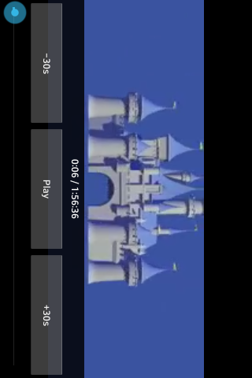

# JellyVideo Legacy

A small Jellyfin movie and TV client for Android 4.0.3+ (API 15), designed for phones such as the LG E610.

[Download the latest release](https://github.com/DerAustistYT/jellyvideo-legacy/releases/latest)

## Features

- Jellyfin Quick Connect login, remembered locally; logout.
- Movies, TV shows, seasons, and episodes.
- Continue watching and resume playback; play from the beginning.
- Search movies, shows, and episodes.
- Favorites and watched/unwatched controls.
- Detail dialogs with descriptions, production year, runtime, and progress state.
- Native landscape player with pause/resume, seek bar, elapsed/total time, and ±30-second jumps.
- Controls hide after 3 seconds of playback and toggle when the video or letterbox area is tapped. Seeking and paused playback keep controls accessible.
- Jellyfin playback-session reporting and transcoding cleanup.
- Quality presets: 240p low data (default), 320p balanced, and 480p higher quality.
- Server-side H.264 baseline/AAC transcoding; no phone-side software video decoder.
- Universal CPU support: native Conscrypt on ARMv7/ARM64/x86/x86_64, with CPU-independent Bouncy Castle TLS 1.2 on ARMv6 or when native TLS cannot load. Certificate and hostname checks remain enabled; the fallback uses a bundled Mozilla CA bundle.
- HTTPS video transport through a private loopback HLS bridge. CPU support does not add video codecs; playback uses the device decoder.

## Low-end performance

Each library page contains at most 40 titles. The artwork cache holds 16 small RGB565 images; only two artwork workers run at once. HLS playlists are rewritten line by line into temporary cache files, and video segments stream with a 16 KB buffer. The full movie is not downloaded first. Large playlists were tested after fixing an initial 256 KB manifest limit.

The 240p preset requests video up to 320×240, 24 fps, 350 kb/s H.264 baseline, plus 96 kb/s AAC audio. The Jellyfin account must allow video and audio transcoding. Server CPU capacity and connection quality affect startup and buffering. Device decoder support still varies.

## Tested status

Quick Connect, movie browsing, movie playback, and automatic control hiding/tap-to-show were confirmed on an **LG E610 running Android 4.0.3**, including universal version 0.3.0. Resume, TV navigation, and other control actions have not all been verified on a physical device. ARMv6, ARM64, x86 and x86_64 video playback have not been device-tested.

Desktop checks verified HLS master/child playlist rewriting, key URLs, unchanged streamed segment bytes, same-origin isolation, route deduplication, and a >256 KB playlist. Compilation and APK signatures were checked.

Small-screen playback controls use equal-width buttons, a separate time row, and reduced button padding. Controls still auto-hide during playback and reappear when the video is tapped.

## Building

Use Android Studio with JDK 17, Android SDK 35, build tools 35.0.0, and Gradle 8.9. The project uses Android Gradle Plugin 8.7.3 and Conscrypt 2.5.2. Build with `gradle assembleDebug` or Android Studio's Build APK action.

## Privacy and credits

No server address, login credentials, local SDK path, or signing key is included in the project. Credentials are kept inside the installed app. The loopback video bridge binds only to 127.0.0.1 and uses a random route secret. Android system backup is disabled for this app.

OpenAI Codex and Anthropic Claude assisted with the original JellyMusic project. Codex implemented this movie/TV client.

## Version 0.2.0

Adds touch-toggle controls over the video, with automatic hiding during playback. Native playback from the preceding build was confirmed on the LG E610; the new control behavior still needs on-device confirmation.

## Screenshots

Movie library on the LG E610:

Player with controls (the LG captures landscape playback in a rotated framebuffer):

## Other editions

See [the four-app catalog](https://github.com/DerAustistYT/jellyfin-legacy-clients) for music/video clients and JellyStone editions for Android 1.5+.
